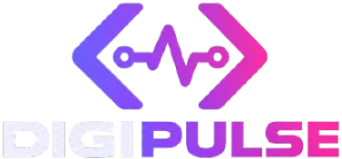

<div align="center">



# DigiPulse

**Studio digital & IoT. Produk digital yang terasa hidup.**

Website resmi DigiPulse: homepage multi-halaman dengan scrollytelling, tipografi kinetik, dan efek AR/VR yang tetap ringan di laptop maupun ponsel.


</div>

---

## Tentang

DigiPulse membantu bisnis dan institusi membuat produk digital yang mudah dipakai, dari website dan aplikasi web sampai desain grafis, video, dan sistem IoT. Repo ini berisi kode website resminya: situs *homepage* multi-halaman (bukan landing page satu layar) dengan animasi berbeda di setiap halaman.

## Halaman & efek

| Halaman | Rute | Efek utama |
|---|---|---|
| Beranda | `/` | **Scrollytelling**: panggung menempel dan berganti bab mengikuti scroll |
| Tentang | `/tentang` | **Latar bergerak**: gradien aurora, partikel interaktif, bentuk cair |
| Layanan | `/layanan`, `/layanan/:slug` | **Tipografi kinetik**: huruf bergelombang, glitch, teks outline berisi gradien |
| Portofolio | `/portofolio`, `/portofolio/:slug` | **Motion graphics AR/VR**: kartu 3D yang miring mengikuti kursor atau sentuhan |
| Produk | `/produk` | **Motion graphics AR/VR**: kubus wireframe, cincin orbit, lantai grid |
| Kontak | `/kontak` | **Motion graphics AR/VR**: formulir pada panel kaca 3D |

## Layanan

Web Development · Web Application · SaaS Development · UI/UX Design · System Integration · IoT & Embedded System · Graphic Design · Video Editing · Maintenance & Support

Setiap layanan punya halaman sendiri berisi cakupan pekerjaan, teknologi (ditampilkan sebagai logo), dan alur kerja.

## Performa

- Halaman dimuat per rute (*lazy-load*), JS awal sekitar 95 kB gzip.
- Animasi hanya memakai `transform` dan `opacity`, tanpa library animasi.
- Partikel canvas dibatasi jumlah dan frame rate di ponsel, serta berhenti saat tidak terlihat.
- Efek 3D bekerja di layar sentuh (goyang otomatis, miring saat disentuh).
- Konten tetap tampil walau animasi tidak berjalan.
- Logo teknologi disajikan lokal dari `public/logos`, tanpa permintaan ke pihak ketiga.

## Teknologi

- **React 19** dan **React Router 7**
- **Vite 8** sebagai build tool
- **Tailwind CSS 4**
- **Lucide React** untuk ikon

## Menjalankan secara lokal

Butuh Node.js 20.19+ atau 22.12+ (syarat Vite 8).

```bash
npm install
npm run dev
```

Buka `http://localhost:5173`.

```bash
npm run build     # build produksi ke folder dist/
npm run preview   # pratinjau hasil build
```

> Situs memakai routing berbasis URL. Saat di-deploy, aktifkan *fallback* ke `index.html` (SPA rewrite) agar tautan langsung seperti `/layanan/web-development` tidak 404.

## Struktur proyek

```
digipulse/
├── public/
│   └── logos/              # logo teknologi (SVG)
├── src/
│   ├── pages/              # Home, About, Services, Portfolio, Products, Contact
│   ├── components/         # Navbar, Footer, ScrollProgress, fx (Tilt, Particles, Marquee, CTA)
│   ├── data.js             # teks layanan, proyek, produk, dan teknologi
│   ├── hooks.js            # reveal on scroll dan scrollytelling
│   ├── images/             # logo
│   ├── App.jsx             # routing
│   ├── main.jsx
│   └── index.css           # tema, warna, dan semua animasi
├── index.html
├── vite.config.js
└── package.json
```

## Mengubah konten dan tampilan

- **Teks**: semua isi layanan, proyek, produk, dan daftar teknologi ada di `src/data.js`.
- **Warna**: variabel warna di bagian atas `src/index.css` (`--primary`, `--accent`, `--background`).
- **Animasi**: kelas dan keyframe tiap efek ada di `src/index.css`.

> Data proyek dan produk saat ini adalah contoh. Ganti dengan data asli sebelum dipublikasikan.

## Lisensi

MIT (sesuai `package.json`). Tambahkan berkas `LICENSE` bila ingin dipublikasikan secara terbuka.
